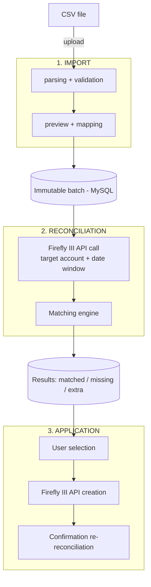

# PRD — Bank Reconciliation for Firefly III

| Field | Value |
|---|---|
| Project | firefly-manager-movement |
| Version | 0.5 |
| Created | 2026-08-14 |
| Last modified | 2026-08-30 |
| Author | A. Delahoz |
| Status | Draft in progress |

---

## 1. Problem and context

Firefly III is a self-hosted personal finance manager. It tracks accounts, budgets, categories and transactions. However, it offers **no native bank reconciliation module**: it is impossible to import a bank statement, compare it with already-recorded transactions, visualize the gaps and create the missing transactions automatically.

Consequences for the user:

- Manual entry — and if time has passed (e.g. a whole week of movements), the user must enter every transaction by hand.
- No completeness guarantee: bank transactions may be missing in Firefly III without anyone noticing.
- No comparative view: impossible to quickly know "what is in the bank but not in my budget".

### Problem statement

> As a Firefly III user, I want to import my bank statements, compare them with existing transactions, clearly see what matches / what is missing, and create the missing transactions in one click so that my financial tracking is exhaustive and without double entry.

---

## 2. Objectives

| # | Objective | Success measure |
|---|---|---|
| O1 | Import bank statements (CSV) without bank-specific configuration | 100% of test files imported successfully |
| O2 | Automatically compare statement vs Firefly III | ≥ 95% of exact matches detected without intervention |
| O3 | Make gaps visible and actionable | User identifies missing items in < 30 s after import |
| O4 | Create missing transactions in Firefly III on demand | 0 transactions created without explicit user action |
| O5 | Clean up duplicates in Firefly III (deletion only on explicit action) | 0 deletions without explicit confirmation |

### Non-goals (v1)

- Direct bank connection via API — the architecture is designed to add it later.
- Bidirectional sync and modification of existing transactions in Firefly III (deletion remains possible only for duplicates, cf. O5).
- Multi-user / multi-household reconciliation.
- Automatic ML categorization of imported transactions.
- Replacement of the official Firefly III Data Importer (complementary tool, not a competitor).

---

## 3. Personas and use cases

### Main persona: "David", self-hosted user

Runs Firefly III in Docker at home. Downloads an XLSX from his bank's website every month. Wants to check that everything is tracked without re-entering data.

### Use cases

| ID | Case | Description |
|---|---|---|
| CU-1 | Import a statement | David uploads a CSV file; the system parses it, detects the format and displays a preview of the movements. |
| CU-2 | Map columns (CSV) | If the CSV is not recognized automatically, David maps columns → fields (date, amount, description, account). |
| CU-3 | Run the reconciliation | David picks the target Firefly III account and starts the comparison. |
| CU-4 | View the results | View in 3 groups: matched / missing in Firefly III / present in Firefly III but absent from the statement. |
| CU-5 | Create the missing transactions | David selects all or part of the missing items, picks counterparty account/category, and confirms creation in Firefly III. |
| CU-6 | Import history | David finds his past imports (batches) and their status. |
| CU-7 | Browse an account's transactions | David picks a Firefly III account and a period (min / max date) and views his transactions, independently of any import. |
| CU-8 | Delete a duplicate | David identifies a duplicated transaction in Firefly III (via the reconciliation or the account view) and deletes it after confirmation. |
| CU-9 | Resume an incomplete import | David resumes a `parsed` batch (with movements) directly at the reconciliation step (step 4 of the wizard), without re-importing the file. |
| CU-10 | Delete an incomplete import | David deletes a `parsed` batch and its movements after explicit confirmation (file name + number of movements); irreversible. |

---

## 4. Functional flow

3-step pipeline: **Import → Reconcile → Apply**.

### States of an imported movement

| State | Meaning |
|---|---|
| `imported` | Present in the batch, not yet reconciled |
| `matched` | Match found in Firefly III |
| `missing` | No match: candidate for creation |
| `created` | Created in Firefly III by the user via the app |
| `ignored` | Manually dismissed by the user (e.g. internal transfer) |

### Batch states and lifecycle

| State | Meaning |
|---|---|
| `parsed` | File parsed, movements stored; reconciliation pending |
| `reconciled` | A reconciliation has been run; results available |
| `applied` | Missing transactions have been created in Firefly III |

Rules:

- `parsed` rows with movements are visually highlighted as incomplete (tooltip "pending reconciliation — step 4").
- **Resume**: from the history, the wizard reopens directly at the reconciliation step (step 4) with the batch preloaded.
- **Delete**: only `parsed` batches can be deleted (movements + batch), after explicit confirmation.
- **Unique file names**: uploading a file whose name already matches an existing batch is refused.

### Matching rules (reconciliation)

Matching criteria:

1. **Amount**: exact equality (comparison in cents/integers, never floats).
2. **Direction**: withdrawal vs deposit must correspond.
3. **Date**: equality with **configurable tolerance** (default ±0 days; options ±1, ±2, ±3 days).
4. **Account**: the reconciliation is always scoped to one target Firefly III account.

User-configurable parameters:

- Date tolerance (days).
- Search window around the statement (default: statement dates ±7 days).

Special cases:

- **Multiple matches** (two movements with identical amount+date): 1-to-1 matching in chronological order; the surplus stays `missing`/`extra`.
- **Duplicates on the Firefly III side**: if several Firefly III transactions match the same bank movement (same amount/direction within the date tolerance), the first (chronological) becomes `matched`; the following ones are flagged `duplicate` in the extras group.
- **Bank fees / interest**: no special handling in v1; they appear as `missing`.

### Result groups

| Group | Content | Possible action |
|---|---|---|
| **Matched** (`matched`) | Movements present on both sides | None (read-only) |
| **Missing** (`missing`) | In the statement, absent from Firefly III | Create in Firefly III (single or batch) |
| **Extras** (`extra`) | In Firefly III, absent from the statement | Informative in v1; deletion possible when flagged `duplicate` |

### Deleting duplicates in Firefly III

- Concerns transactions flagged `duplicate` by the reconciliation engine, visible in the extras group.
- The user views the transaction details, then explicitly confirms deletion (double confirmation with recap).
- Deletion calls the Firefly III API (`DELETE /api/v1/transactions/{id}`).
- Before deletion, a JSON snapshot of the transaction is kept in the database (audit) for traceability.
- **No deletion happens without explicit action.** No automatic or batch deletion in v1.

### Browsing an account's transactions

- The user picks a Firefly III account and a period (min / max date).
- The system displays the account's transactions over the period (via the Firefly III API), with their details.
- This view is independent of any import batch; it also serves to spot duplicates outside a reconciliation.

### Creating missing transactions

- The user selects the movements to create (checkbox + "select all").
- Required fields before creation: counterparty account (expense/income account or asset account depending on direction). Optional fields: category, budget, notes.
- Creation calls the Firefly III API (`POST /api/v1/transactions`) with: type, amount, date, description (from the statement), source/destination account, and a tag/notes tracing the origin (file name + batch id).
- After creation, the movement moves to `created` and an incremental re-reconciliation confirms the match.
- **No creation happens without explicit action.** No automatic mode in v1.

---

## 5. Functional requirements

| ID | Requirement | Priority |
|---|---|---|
| RF-01 | The system allows uploading CSV files (max size 10 MB). XLSX files must be manually converted to CSV by the user before import. | P0 |
| RF-02 | The system parses the CSV with manual column mapping; it memorizes the mapping by file signature (headers). | P0 |
| RF-03 | The system detects and reports invalid lines (unreadable date, empty amount) without blocking the import; valid lines are kept. | P0 |
| RF-04 | The system lists Firefly III asset accounts to choose the reconciliation target account. | P0 |
| RF-05 | The system fetches the target account's transactions via the Firefly III API over the date window. | P0 |
| RF-06 | The reconciliation engine applies the section 4 rules with configurable date tolerance. | P0 |
| RF-07 | Results are presented in 3 groups (matched / missing / extras) with visual highlighting of the gaps. | P0 |
| RF-08 | The user can batch-create the missing transactions in Firefly III. | P0 |
| RF-09 | Each import batch is immutable and viewable a posteriori (history). | P1 |
| RF-10 | The user can manually ignore a movement (`ignored`). | P1 |
| RF-11 | Created transactions carry an origin trace (tag or note: file + batch). | P1 |
| RF-12 | The system handles multiple currencies: the statement currency must match the target account's, otherwise a blocking warning. | P1 |
| RF-13 | The user can re-run a reconciliation on an existing batch. | P1 |
| RF-14 | The system displays the transactions of a selected Firefly III account over a given period (min / max date). | P0 |
| RF-15 | The system flags duplicates (several Firefly III transactions matching the same bank movement) and allows unit deletion with double confirmation; a JSON snapshot of the deleted transaction is kept for audit. | P0 |
| RF-16 | The system refuses uploading a file whose name matches an existing batch: pre-check in the import wizard (inline error, no upload) and 409 Conflict from the backend. | P1 |
| RF-17 | The user can delete an import in `parsed` status after explicit confirmation (recap: file name + movement count). Deletion removes the movements and the batch, is irreversible, and is refused for `reconciled`/`applied` batches. | P1 |
| RF-18 | The user can resume an incomplete import: from the history, the wizard reopens directly at the reconciliation step (step 4) with the target batch preloaded. | P1 |

> **Amendment (v0.4, 2026-08-28) — RF-12**: the statement currency is no longer manually selected at import. It is **derived from the Firefly III account selected** in the import wizard (the frontend transmits that currency to the backend; API contract unchanged). The blocking warning remains when switching to an account with a different currency during reconciliation or a re-run.

> **Amendment (v0.5, 2026-08-30) — wizard UX and incomplete imports (RF-16..RF-18)**:
> - The import wizard state resets on every opening: a cancelled session never leaves a stale step behind.
> - When the CSV requires manual mapping (0 valid rows, no memorized or auto-detected mapping), the preview displays an explanatory message instead of an empty table.
> - Mapping probes (headers-only batches with 0 movements, uploaded to detect the mapping) are automatically deleted before re-uploading the file with the confirmed mapping — no orphan batches.

## 6. Non-functional requirements

| ID | Requirement |
|---|---|
| NFR-01 | **Architecture**: standalone web app; Rust backend, React frontend, MySQL database. Deployable with Docker Compose. |
| NFR-02 | **Security**: the Firefly III API token is stored backend-side only (environment variables / local vault), never exposed to the browser. No banking data is sent to a third-party service. |
| NFR-03 | **Privacy**: self-hosted only; no telemetry. |
| NFR-04 | **Performance**: reconciliation of a 1,000-movement statement < 5 s (excluding Firefly III API latency). |
| NFR-05 | **Reliability**: creations in Firefly III are idempotent per batch+movement (no double creation on retry). |
| NFR-06 | **Amounts**: handled as integers (cents) or exact decimals, never floats. |
| NFR-07 | **Observability**: structured logs of imports, reconciliations and creations. |
| NFR-08 | **Internationalization**: UI in French, English and Spanish (default: English); amounts and dates formatted per locale. |

---

## 7. Tech stack (overview)

| Layer | Choice |
|---|---|
| Backend | Rust |
| Frontend | React |
| Database | MySQL |
| Deployment | Docker Compose |

Technical details (data model, endpoints, Firefly III API integration) are described in the TRD: [`2026-08-14-trd-architecture-technique.md`](./2026-08-14-trd-architecture-technique.md).

---

## 8. Success metrics

| Metric | Target |
|---|---|
| Parse success rate on real files | ≥ 98% |
| Matching precision (exact matches detected) | ≥ 95% |
| Matching false positives | < 1% |
| Time from upload to the missing list | < 30 s |
| Transactions created without user action | 0 |
| Transactions deleted without explicit confirmation | 0 |

---

## 9. Risks and mitigations

| Risk | Impact | Mitigation |
|---|---|---|
| Highly heterogeneous CSV formats across banks | Import failure | Manual mapping + memorization by header signature; extensible library of known formats |
| Firefly III API pagination/volume on long windows | Slow/incomplete reconciliation | Exhaustive client-side pagination; bounded date window |
| Legitimate bank-side duplicates (same amount/date) | Incorrect 1-to-1 matching | Chronological pairing + manual review of surplus |
| Accidental batch creation | Polluting Firefly III | Explicit confirmation, traceability (batch tag), never auto-create |
| Accidental transaction deletion | Data loss in Firefly III | Double confirmation with recap, scope limited to transactions visible in context (reconciliation/period), JSON audit snapshot kept in database |
| Compromised API token | Full access to Firefly III | Backend-only token, documented rotation |
| Duplicate file names | Confusing import history, ambiguous resume | Unique file name among batches: client-side pre-check + backend 409 (RF-16) |

---

## 10. Out of scope / future

- **V2**: direct bank connection through the same pipeline (the connector replaces the upload).
- **V2**: native support for other file formats (OFX, XLSX, parsing without manual conversion).
- **V2**: description-based matching rules (fuzzy), counterparty suggestions.
- **V2**: `extra` group handling (mark as expected, alerts).
- **V3**: automatic categorization, completeness reports, multi-account in one reconciliation.

---

## 11. Glossary

| Term | Definition |
|---|---|
| Reconciliation | Systematic comparison of two transaction sets to identify matches and gaps |
| Batch | Immutable set of movements from an imported file |
| Matching | Rules determining whether a statement movement corresponds to a Firefly III transaction |
| Missing (`missing`) | Movement present in the bank statement but absent from Firefly III |
| Extra (`extra`) | Transaction present in Firefly III but absent from the statement |
| Date tolerance | Maximum gap in days accepted between two dates to consider a match |
| Mapping probe | Headers-only batch (0 movements) uploaded to detect a CSV column mapping, deleted once the mapping is confirmed |
