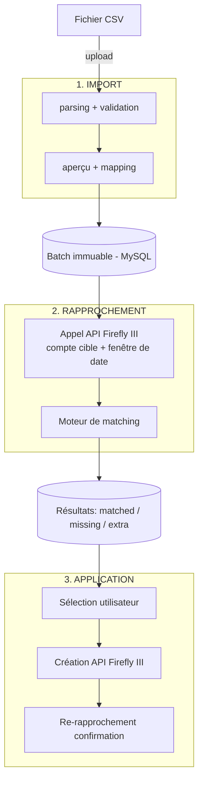

# PRD — Rapprochement bancaire pour Firefly III

| Champ | Valeur |
|---|---|
| Projet | firefly-manager-movement |
| Version | 0.3 |
| Créé le | 2026-08-14 |
| Dernière modification | 2026-08-17 |
| Auteur | A. Delahoz |
| Statut | En cours de rédaction |

---

## 1. Problème et contexte

Firefly III est un gestionnaire de finances personnelles self-hosted. Il permet de suivre comptes, budgets, catégories et transactions. Cependant, il ne propose **aucun module natif de rapprochement bancaire** : il est impossible d'importer un relevé de transactions bancaires, de le comparer aux transactions déjà enregistrées, de visualiser les écarts et de créer automatiquement les transactions manquantes.

Conséquences pour l'utilisateur :

- Saisie manuelle et parfois si la personne a laissé passé le temps, par exemple, il va y a voir mouvement de toute une semaine et la personne doit saise manuellement.
- Aucune garantie d'exhaustivité : des transactions bancaires peuvent manquer dans Firefly III sans que personne ne s'en aperçoive.
- Aucune vue comparative : impossible de savoir rapidement « ce qui est dans la banque mais pas dans mon budget ».

### Énoncé du problème

> En tant qu'utilisateur de Firefly III, je veux importer mes relevés bancaires, les comparer aux transactions existantes, voir clairement ce qui correspond / ce qui manque, et créer en un clic les transactions manquantes afin que mon suivi financier soit exhaustif et sans double saisie.

---

## 2. Objectifs

| # | Objectif | Mesure de succès |
|---|---|---|
| O1 | Importer des relevés bancaires (CSV) sans configuration bancaire | 100 % des fichiers de test importés avec succès |
| O2 | Comparer automatiquement relevé vs Firefly III | ≥ 95 % des correspondances exactes détectées sans intervention |
| O3 | Rendre les écarts visibles et actionnables | L'utilisateur identifie les manquants en < 30 s après import |
| O4 | Créer les transactions manquantes dans Firefly III à la demande | 0 transaction créée sans action explicite de l'utilisateur |
| O5 | Nettoyer les doublons dans Firefly III (suppression sur action explicite) | 0 suppression sans confirmation explicite |

### Non-objectifs (v1)

- Connexion directe aux banques via API architecture prévue pour l'ajouter ensuite.
- Synchronisation bidirectionnelle et modification de transactions existantes dans Firefly III (la suppression reste possible uniquement pour les doublons, cf. O5).
- Rapprochement multi-utilisateurs / multi-foyers.
- Catégorisation automatique par ML des transactions importées.
- Remplacement du Data Importer officiel de Firefly III (outil complémentaire, pas concurrent).

---

## 3. Personas et cas d'utilisation

### Persona principal : « David », utilisateur self-hosted

Utilise Firefly III en Docker chez lui. Télécharge chaque mois un XLSX depuis le site de sa banque. Veut vérifier que tout est bien tracé sans ressaisir.

### Cas d'utilisation

| ID | Cas | Description |
|---|---|---|
| CU-1 | Importer un relevé | David upload un fichier CSV ; le système le parse, détecte le format et affiche un aperçu des mouvements. |
| CU-2 | Mapper les colonnes (CSV) | Si le CSV n'est pas reconnu automatiquement, David mappe colonnes → champs (date, montant, description, compte). |
| CU-3 | Lancer le rapprochement | David choisit le compte Firefly III cible et lance la comparaison. |
| CU-4 | Consulter les résultats | Vue en 3 groupes : rapprochés / manquants dans Firefly III / présents dans Firefly III mais absents du relevé. |
| CU-5 | Créer les manquants | David sélectionne tout ou partie des manquants, choisit compte de contrepartie/catégorie, et valide la création dans Firefly III. |
| CU-6 | Historique des imports | David retrouve ses imports passés (batchs) et leur état. |
| CU-7 | Consulter les mouvements d'un compte | David choisit un compte Firefly III et une période (date min / date max) et consulte la liste de ses mouvements, indépendamment de tout import. |
| CU-8 | Supprimer un doublon | David identifie une transaction dupliquée dans Firefly III (via le rapprochement ou la vue compte) et la supprime après confirmation. |

---

## 4. Flux fonctionnel

Pipeline en 3 étapes : **Importer → Rapprocher → Appliquer**.

### États d'un mouvement importé

| État | Signification |
|---|---|
| `imported` | Présent dans le batch, pas encore rapproché |
| `matched` | Correspondance trouvée dans Firefly III |
| `missing` | Aucune correspondance : candidat à la création |
| `created` | Créé dans Firefly III par l'utilisateur via l'app |
| `ignored` | Écarté manuellement par l'utilisateur (ex. virement interne) |

### Règles de rapprochement (matching)

Critères de correspondance :

1. **Montant** : égalité exacte (comparaison en centimes/entiers, jamais en flottants).
2. **Sens** : retrait vs dépôt doit correspondre.
3. **Date** : égalité avec **tolérance configurable** (défaut ±0 jour ; options ±1, ±2, ±3 jours).
4. **Compte** : le rapprochement est toujours limité à un compte Firefly III cible.

Paramètres configurables par l'utilisateur :

- Tolérance de date (jours).
- Fenêtre de recherche autour du relevé (défaut : dates du relevé ±7 jours).

Cas particuliers :

- **Correspondances multiples** (deux mouvements identiques montant+date) : matching 1-pour-1 par ordre chronologique ; les excédents restent `missing`/`extra`.
- **Doublons côté Firefly III** : si plusieurs transactions Firefly III correspondent au même mouvement bancaire (même montant/sens dans la tolérance de date), la première (chronologique) devient `matched` ; les suivantes sont signalées `duplicate` dans le groupe extras.
- **Frais bancaires / intérêts** : aucun traitement spécial en v1 ; ils apparaissent comme `missing`.

### Groupes de résultat

| Groupe | Contenu | Action possible |
|---|---|---|
| **Rapprochés** (`matched`) | Mouvements présents des deux côtés | Aucune (lecture seule) |
| **Manquants** (`missing`) | Dans le relevé, absents de Firefly III | Créer dans Firefly III (individuel ou en lot) |
| **Extras** (`extra`) | Dans Firefly III, absents du relevé | Informatif en v1 ; suppression possible si signalé `duplicate` |

### Suppression des doublons dans Firefly III

- Concerne les transactions signalées `duplicate` par le moteur de rapprochement, visibles dans le groupe extras.
- L'utilisateur consulte le détail de la transaction, puis confirme explicitement la suppression (double confirmation avec récapitulatif).
- La suppression appelle l'API Firefly III (`DELETE /api/v1/transactions/{id}`).
- Avant suppression, un snapshot JSON de la transaction est conservé en base (audit) pour traçabilité.
- **Aucune suppression n'est faite sans action explicite.** Pas de suppression automatique ni en lot en v1.

### Consultation des mouvements d'un compte

- L'utilisateur choisit un compte Firefly III et une période (date min / date max).
- Le système affiche les mouvements du compte sur la période (via l'API Firefly III), avec leurs détails.
- Cette vue est indépendante de tout batch d'import ; elle sert aussi à repérer des doublons hors rapprochement.

### Création des transactions manquantes

- L'utilisateur sélectionne les mouvements à créer (checkbox + « tout sélectionner »).
- Champs requis avant création : compte de contrepartie (compte de dépenses/recettes ou compte d'actif selon le sens). Champs optionnels : catégorie, budget, notes.
- La création appelle l'API Firefly III (`POST /api/v1/transactions`) avec : type, montant, date, description (issue du relevé), compte source/destination, et un tag/notes traçant l'origine (nom du fichier + id de batch).
- Après création, le mouvement passe à l'état `created` et un re-rapprochement incrémental confirme la correspondance.
- **Aucune création n'est faite sans action explicite.** Pas de mode automatique en v1.

---

## 5. Exigences fonctionnelles

| ID | Exigence | Priorité |
|---|---|---|
| RF-01 | Le système permet l'upload de fichiers CSV (taille max 10 Mo). Les fichiers XLSX doivent être convertis manuellement en CSV par l'utilisateur avant import. | P0 |
| RF-02 | Le système parse le CSV avec mapping manuel des colonnes ; il mémorise le mapping par signature de fichier (en-têtes). | P0 |
| RF-03 | Le système détecte et signale les lignes invalides (date illisible, montant vide) sans bloquer l'import ; les lignes valides sont conservées. | P0 |
| RF-04 | Le système liste les comptes d'actif Firefly III pour choisir le compte cible du rapprochement. | P0 |
| RF-05 | Le système récupère les transactions du compte cible via l'API Firefly III sur la fenêtre de date. | P0 |
| RF-06 | Le moteur de rapprochement applique les règles de la section 4 avec tolérance de date configurable. | P0 |
| RF-07 | Les résultats sont présentés en 3 groupes (rapprochés / manquants / extras) avec mise en évidence visuelle des écarts. | P0 |
| RF-08 | L'utilisateur peut créer en lot les transactions manquantes dans Firefly III. | P0 |
| RF-09 | Chaque batch d'import est immuable et consultable a posteriori (historique). | P1 |
| RF-10 | L'utilisateur peut ignorer manuellement un mouvement (`ignored`). | P1 |
| RF-11 | Les transactions créées portent une trace d'origine (tag ou note : fichier + batch). | P1 |
| RF-12 | Le système gère plusieurs devises : la devise du relevé doit correspondre à celle du compte cible, sinon avertissement bloquant. | P1 |
| RF-13 | L'utilisateur peut re-lancer un rapprochement sur un batch existant. | P1 |
| RF-14 | Le système affiche les mouvements d'un compte Firefly III sélectionné sur une période donnée (date min / date max). | P0 |
| RF-15 | Le système signale les doublons (plusieurs transactions Firefly III correspondant au même mouvement bancaire) et permet leur suppression unitaire avec double confirmation ; un snapshot JSON de la transaction supprimée est conservé en audit. | P0 |

## 6. Exigences non fonctionnelles

| ID | Exigence |
|---|---|
| NFR-01 | **Architecture** : application web indépendante ; backend Rust, frontend React, base MySQL. Déployable en Docker Compose. |
| NFR-02 | **Sécurité** : le token d'API Firefly III est stocké côté backend uniquement (variables d'environnement / coffre local), jamais exposé au navigateur. Aucune donnée bancaire n'est envoyée à un service tiers. |
| NFR-03 | **Confidentialité** : self-hosted uniquement ; aucune télémétrie. |
| NFR-04 | **Performance** : rapprochement d'un relevé de 1 000 mouvements < 5 s (hors latence API Firefly III). |
| NFR-05 | **Fiabilité** : les créations dans Firefly III sont idempotentes par batch+mouvement (pas de double création en cas de retry). |
| NFR-06 | **Montants** : manipulés en entiers (centimes) ou decimal exact, jamais en flottants. |
| NFR-07 | **Observabilité** : logs structurés des imports, rapprochements et créations. |
| NFR-08 | **Internationalisation** : interface en français, anglais et espagnol (défaut : anglais) ; montants et dates formatés selon la locale. |

---

## 7. Stack technique (vue d'ensemble)

| Couche | Choix |
|---|---|
| Backend | Rust |
| Frontend | React |
| Base de données | MySQL |
| Déploiement | Docker Compose |

Le détail technique (modèle de données, endpoints, intégration API Firefly III) est décrit dans le TRD : [`2026-08-14-trd-architecture-technique.md`](./2026-08-14-trd-architecture-technique.md).

---

## 8. Métriques de succès

| Métrique | Cible |
|---|---|
| Taux de lignes parsées avec succès sur fichiers réels | ≥ 98 % |
| Précision du matching (correspondances exactes détectées) | ≥ 95 % |
| Faux positifs de matching | < 1 % |
| Temps pour passer de l'upload à la liste des manquants | < 30 s |
| Transactions créées sans action utilisateur | 0 |
| Transactions supprimées sans confirmation explicite | 0 |

---

## 9. Risques et mitigations

| Risque | Impact | Mitigation |
|---|---|---|
| Formats CSV très hétérogènes selon les banques | Import en échec | Mapping manuel + mémorisation par signature d'en-têtes ; bibliothèque de formats connus extensible |
| Pagination/volume de l'API Firefly III sur longues fenêtres | Rapprochement lent/incomplet | Pagination exhaustive côté client API ; fenêtre de date bornée |
| Doublons côté banque (même montant/date légitimes) | Matching 1-pour-1 incorrect | Appariement chronologique + revue manuelle des excédents |
| Création accidentelle en lot | Pollution de Firefly III | Confirmation explicite, traçabilité (tag batch), jamais d'auto-création |
| Suppression accidentelle d'une transaction | Perte de données dans Firefly III | Double confirmation avec récapitulatif, scope limité aux transactions visibles dans le contexte (rapprochement/période), snapshot JSON d'audit conservé en base |
| Token API compromis | Accès complet à Firefly III | Token côté backend uniquement, rotation documentée |

---

## 10. Hors périmètre / futur

- **V2** : connexion bancaire directe via le même pipeline (le connecteur remplace l'upload).
- **V2** : support natif d'autres formats de fichiers (OFX, XLSX, parsing sans conversion manuelle).
- **V2** : règles de matching par description (fuzzy), suggestions de contrepartie.
- **V2** : gestion du groupe `extra` (marquer comme attendu, alertes).
- **V3** : catégorisation automatique, rapports d'exhaustivité, multi-comptes en un rapprochement.

---

## 11. Glossaire

| Terme | Définition |
|---|---|
| Rapprochement (reconciliation) | Comparaison systématique de deux jeux de transactions pour identifier correspondances et écarts |
| Batch | Ensemble immuable des mouvements issus d'un fichier importé |
| Matching | Règles déterminant si un mouvement du relevé correspond à une transaction Firefly III |
| Manquant (`missing`) | Mouvement présent dans le relevé bancaire mais absent de Firefly III |
| Extra (`extra`) | Transaction présente dans Firefly III mais absente du relevé |
| Tolérance de date | Écart maximal en jours accepté entre deux dates pour considérer une correspondance |
