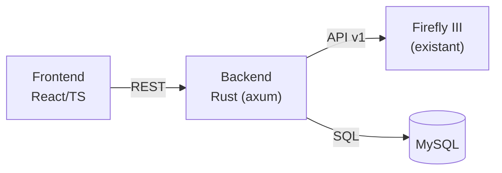
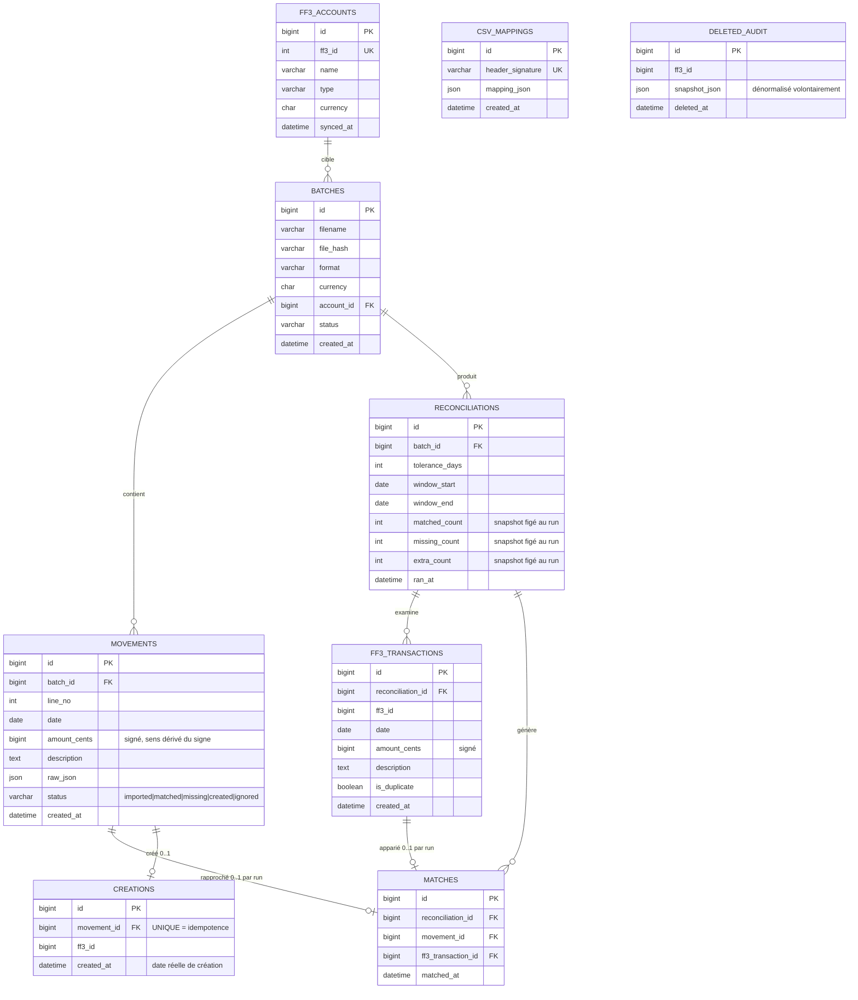

# TRD — Architecture technique du rapprochement bancaire

| Champ | Valeur |
|---|---|
| Projet | firefly-manager-movement |
| Version | 0.3 |
| Créé le | 2026-08-14 |
| Dernière modification | 2026-08-28 |
| PRD associé | [`2026-08-14-prd-rapprochement-bancaire.md`](./2026-08-14-prd-rapprochement-bancaire.md) |
| Statut | En cours de rédaction |

---

## 1. Vue d'ensemble

Application web self-hosted en 3 services, déployable en Docker Compose à côté de Firefly III :

| Service | Technologie | Rôle |
|---|---|---|
| Backend | Rust — axum + tokio, reqwest (client HTTP), Diesel (ORM, MySQL) | API REST interne, parsing CSV, moteur de rapprochement, client Firefly III |
| Frontend | React + Vite + TypeScript | SPA : upload, mapping, tableau de rapprochement, création en lot |
| Base | MySQL 8 | Persistance des batchs, mouvements, résultats, mappings CSV |

## 2. Modèle de données

Contraintes clés :

- `movements` : `UNIQUE(batch_id, line_no)`, `CHECK amount_cents != 0`. Pas de colonne `direction` : le sens se déduit du signe de `amount_cents` (règle de matching « sens » = comparaison de signes).
- `matches` : `UNIQUE(reconciliation_id, movement_id)` + `UNIQUE(reconciliation_id, ff3_transaction_id)` → le 1-pour-1 est garanti par le schéma, plus par convention. Historisé par run de rapprochement.
- `creations` : `UNIQUE(movement_id)` → idempotence de création (NFR-05). Contient la date réelle de création et la provenance (« créé par nous »).
- `ff3_transactions` : `UNIQUE(reconciliation_id, ff3_id)`. Cache par run : les groupes `extra` et le flag `duplicate` y vivent (résout RF-13 re-rapprochement et RF-15 doublons).
- `ff3_accounts` : `UNIQUE(ff3_id)`. Cache local synchronisé à la demande (au lancement du rapprochement ou via endpoint dédié) ; évite des appels API répétés et donne un nom affichable.
- `amount_cents` : BIGINT signé (centimes), jamais de flottant (NFR-06).
- `raw_json` : ligne brute du fichier, pour audit et re-parsing.
- Dénormalisations assumées et justifiées :
  - compteurs de `reconciliations` = snapshot figé au moment du run (audit) ;
  - `movements.status` = état courant issu du dernier run + actions utilisateur, indexé pour le filtrage ;
  - `deleted_audit.snapshot_json` = point-in-time, intentionnellement non normalisé.
- Sémantique de `movements.status` : reflète le dernier run (`imported` → `matched`/`missing`) ; `created` et `ignored` sont posés par action utilisateur. Un re-rapprochement confirmatoire fait passer `created` → `matched` sans perte d'info (la provenance reste dans `creations`).
- Index : `movements(batch_id, status)`, `movements(batch_id, date)`, `ff3_transactions(reconciliation_id, amount_cents)`.

## 3. API backend

| Méthode | Route | Rôle |
|---|---|---|
| POST | `/api/imports` | Upload fichier → création batch + parse |
| GET | `/api/imports` / `/api/imports/{id}` | Liste / détail batch |
| PUT | `/api/imports/{id}/mapping` | Enregistrer mapping CSV |
| POST | `/api/imports/{id}/reconcile` | Lancer le rapprochement |
| GET | `/api/imports/{id}/results` | Résultats en 3 groupes |
| POST | `/api/imports/{id}/apply` | Créer les manquants sélectionnés dans Firefly III |
| GET | `/api/firefly/accounts` | Proxy lecture des comptes d'actif |
| QUERY | `/api/firefly/accounts/{id}/transactions` | Proxy lecture des mouvements d'un compte sur une période — filtres en body : `{start, end}` (RF-14) |
| DELETE | `/api/firefly/transactions/{id}` | Suppression d'un doublon avec snapshot d'audit (RF-15) |

Notes :

- Devise du batch (`POST /api/imports`, champ `currency`) : depuis la v1.5 du frontend, elle est **dérivée du compte FF3 sélectionné** dans l'assistant d'import et transmise telle quelle ; le backend conserve son défaut `EUR` si le champ est absent (contrat inchangé).
- `POST /apply` est idempotent par mouvement : avant chaque création, vérifier l'existence d'une ligne dans `creations` (`UNIQUE(movement_id)`, NFR-05) ; ignorer les mouvements déjà créés.
- Erreurs de l'API Firefly III lors d'un `apply` en lot : traitement par mouvement, le lot continue, rapport final par mouvement (succès/échec/raison).
- **Méthode QUERY (RFC 9295)** : utilisée uniquement pour les routes à filtres complexes en body (lectures avec critères de recherche). Les récupérations simples par ID ou listes complètes restent en GET. Le backend traduit `QUERY` → `GET` lors de l'appel à l'API Firefly III (qui reste en GET). Nécessite d'enregistrer la méthode explicitement dans axum (`Route::on("QUERY", handler)` ou macro équivalente).

## 4. Intégration Firefly III (API v1)

| Usage | Endpoint |
|---|---|
| Auth | Header `Authorization: Bearer <token>` (personal access token ; OAuth2 supporté aussi) |
| Comptes | `GET /api/v1/accounts?type=asset` |
| Transactions | `GET /api/v1/accounts/{id}/transactions?start=..&end=..` (pagination exhaustive) — appelé par le backend en traduisant notre `QUERY` interne |
| Création | `POST /api/v1/transactions` |
| Suppression | `DELETE /api/v1/transactions/{id}` |
| Santé | `GET /api/v1/about` |

Configuration backend (variables d'environnement) :

| Variable | Description |
|---|---|
| `FF3_URL` | URL de l'instance Firefly III |
| `FF3_TOKEN` | Token API (jamais exposé au frontend, NFR-02) |
| `DATABASE_URL` | Chaîne de connexion MySQL |
| `MATCH_TOLERANCE_DAYS` | Tolérance de date par défaut (défaut 0) |

Le frontend ne parle jamais directement à Firefly III : tout passe par le backend.

## 5. Parsing des fichiers

- **CSV** : détection du délimiteur et de l'encodage ; si les en-têtes correspondent à un mapping mémorisé (`csv_mappings.header_signature`, hash des en-têtes normalisés), application automatique ; sinon mapping manuel requis. Les fichiers XLSX doivent être convertis en CSV par l'utilisateur avant import (support natif XLSX/OFX prévu en V2).
- Lignes invalides : conservées avec erreur attachée, exposées dans l'aperçu (RF-03).

## 6. Moteur de rapprochement

1. Charger les mouvements du batch (`status != ignored`).
2. Récupérer les transactions Firefly III du compte cible sur `[min_date - fenêtre, max_date + fenêtre]`, pagination exhaustive.
3. Indexer les deux jeux par clé `montant_cents` (le sens est encodé dans le signe de chaque montant).
4. Pour chaque clé, apparier chronologiquement 1-pour-1 dans la tolérance de date ; les transactions Firefly III surnuméraires face à un même mouvement bancaire sont marquées `is_duplicate = true` (RF-15).
5. Produire les 3 groupes ; persister une ligne `reconciliations` (compteurs snapshot) + les `ff3_transactions` examinées (avec flag `is_duplicate`) + les `matches` 1-pour-1 ; mettre à jour les statuts des mouvements (`imported` → `matched`/`missing`).

Complexité cible : O(n log n) sur le relevé ; 1 000 mouvements < 5 s hors latence API (NFR-04).

## 7. Déploiement

Docker Compose : 3 services (`backend`, `frontend`, `mysql`) + réseau partagé avec l'instance Firefly III existante. Migrations de schéma gérées par Diesel (`diesel migration run`) au démarrage du backend.

Note ORM : Diesel est synchrone par défaut ; l'intégration avec axum/tokio se fait via `diesel-async` (pool MySQL async) pour ne pas bloquer le runtime.

## 8. Décisions ouvertes

| # | Sujet | Options |
|---|---|---|
| D1 | Framework backend Rust | axum (recommandé) vs actix-web |
| D2 | Représentation des montants | **Tranché** : BIGINT signé (centimes), sens dérivé du signe — pas de colonne `direction` ni de DECIMAL. |
| D3 | Stratégie de re-rapprochement après `apply` | complet vs incrémental sur les mouvements créés |
