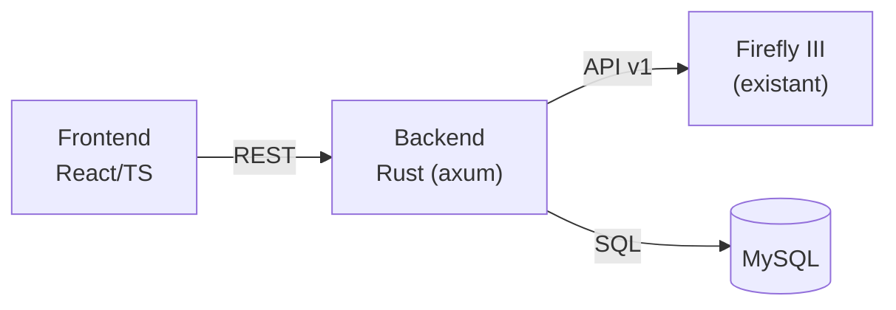

# TRD — Architecture technique du rapprochement bancaire

| Champ | Valeur |
|---|---|
| Projet | firefly-manager-movement |
| Version | 0.2 |
| Créé le | 2026-08-14 |
| Dernière modification | 2026-08-15 |
| PRD associé | [`2026-08-14-prd-rapprochement-bancaire.md`](./2026-08-14-prd-rapprochement-bancaire.md) |
| Statut | En cours de rédaction |

---

## 1. Vue d'ensemble

Application web self-hosted en 3 services, déployable en Docker Compose à côté de Firefly III :



| Service | Technologie | Rôle |
|---|---|---|
| Backend | Rust — axum + tokio, reqwest (client HTTP), Diesel (ORM, MySQL) | API REST interne, parsing CSV/OFX, moteur de rapprochement, client Firefly III |
| Frontend | React + Vite + TypeScript | SPA : upload, mapping, tableau de rapprochement, création en lot |
| Base | MySQL 8 | Persistance des batchs, mouvements, résultats, mappings CSV |

## 2. Modèle de données

```
batches(id, filename, file_hash, format, currency, account_ff3_id,
        status, created_at)
movements(id, batch_id, line_no, date, amount_cents, direction,
          description, raw_json, status[imported|matched|missing|created|ignored],
          ff3_transaction_id NULL, created_at)
reconciliations(id, batch_id, tolerance_days, window_start, window_end,
                matched, missing, extra, ran_at)
csv_mappings(id, header_signature, mapping_json, created_at)
deleted_audit(id, ff3_transaction_id, snapshot_json, deleted_at)
```

Contraintes clés :

- Unicité `(batch_id, line_no)` sur `movements`.
- Unicité `(batch_id, ff3_transaction_id)` quand non NULL (idempotence de création, NFR-05).
- `amount_cents` : BIGINT signé ou paire (montant entier + sens) — jamais de flottant (NFR-06).
- `raw_json` : ligne brute du fichier, pour audit et re-parsing.
- Index : `(batch_id, status)`, `(batch_id, date)`.

## 3. API backend

| Méthode | Route | Rôle |
|---|---|---|
| POST | `/api/imports` | Upload fichier → création batch + parse |
| GET | `/api/imports` / `/api/imports/{id}` | Liste / détail batch |
| PUT | `/api/imports/{id}/mapping` | Enregistrer mapping CSV |
| POST | `/api/imports/{id}/reconcile` | Lancer le rapprochement |
| GET | `/api/imports/{id}/results` | Résultats en 3 groupes |
| POST | `/api/imports/{id}/apply` | Créer les manquants sélectionnés dans Firefly III |
| GET | `/api/firefly/accounts` | Proxy lecture des comptes d'actif |
| GET | `/api/firefly/accounts/{id}/transactions?start=..&end=..` | Proxy lecture des mouvements d'un compte sur une période (RF-15) |
| DELETE | `/api/firefly/transactions/{id}` | Suppression d'un doublon avec snapshot d'audit (RF-16) |

Notes :

- `POST /apply` est idempotent par `(batch, movement)` : avant chaque création, vérifier l'état en base ; ignorer les mouvements déjà `created`.
- Erreurs de l'API Firefly III lors d'un `apply` en lot : traitement par mouvement, le lot continue, rapport final par mouvement (succès/échec/raison).

## 4. Intégration Firefly III (API v1)

| Usage | Endpoint |
|---|---|
| Auth | Header `Authorization: Bearer <token>` (personal access token ; OAuth2 supporté aussi) |
| Comptes | `GET /api/v1/accounts?type=asset` |
| Transactions | `GET /api/v1/accounts/{id}/transactions?start=..&end=..` (pagination exhaustive) |
| Création | `POST /api/v1/transactions` |
| Suppression | `DELETE /api/v1/transactions/{id}` |
| Santé | `GET /api/v1/about` |

Configuration backend (variables d'environnement) :

| Variable | Description |
|---|---|
| `FF3_URL` | URL de l'instance Firefly III |
| `FF3_TOKEN` | Token API (jamais exposé au frontend, NFR-02) |
| `DATABASE_URL` | Chaîne de connexion MySQL |
| `MATCH_TOLERANCE_DAYS` | Tolérance de date par défaut (défaut 0) |

Le frontend ne parle jamais directement à Firefly III : tout passe par le backend.

## 5. Parsing des fichiers

- **OFX** : parseur dédié (structure normalisée, pas de mapping nécessaire).
- **CSV** : détection du délimiteur et de l'encodage ; si les en-têtes correspondent à un mapping mémorisé (`csv_mappings.header_signature`, hash des en-têtes normalisés), application automatique ; sinon mapping manuel requis.
- Lignes invalides : conservées avec erreur attachée, exposées dans l'aperçu (RF-04).

## 6. Moteur de rapprochement

1. Charger les mouvements du batch (`status != ignored`).
2. Récupérer les transactions Firefly III du compte cible sur `[min_date - fenêtre, max_date + fenêtre]`, pagination exhaustive.
3. Indexer les deux jeux par clé `(montant_cents, sens)`.
4. Pour chaque clé, apparier chronologiquement 1-pour-1 dans la tolérance de date ; les transactions Firefly III surnuméraires face à un même mouvement bancaire sont marquées `duplicate` (RF-16).
5. Produire les 3 groupes ; persister une ligne `reconciliations` + mise à jour des statuts des mouvements.

Complexité cible : O(n log n) sur le relevé ; 1 000 mouvements < 5 s hors latence API (NFR-04).

## 7. Déploiement

Docker Compose : 3 services (`backend`, `frontend`, `mysql`) + réseau partagé avec l'instance Firefly III existante. Migrations de schéma gérées par Diesel (`diesel migration run`) au démarrage du backend.

Note ORM : Diesel est synchrone par défaut ; l'intégration avec axum/tokio se fait via `diesel-async` (pool MySQL async) pour ne pas bloquer le runtime.

## 8. Décisions ouvertes

| # | Sujet | Options |
|---|---|---|
| D1 | Framework backend Rust | axum (recommandé) vs actix-web |
| D2 | Représentation des montants | BIGINT centimes (recommandé) vs DECIMAL(19,4) |
| D3 | Stratégie de re-rapprochement après `apply` | complet vs incrémental sur les mouvements créés |
