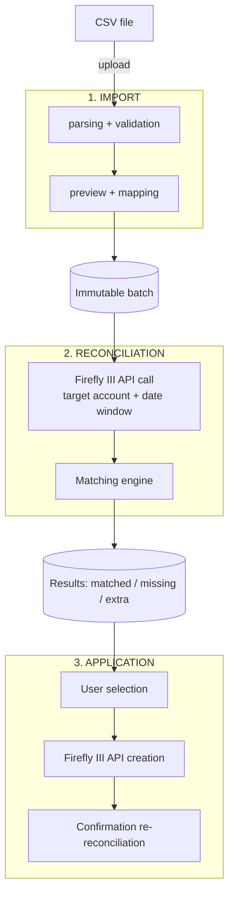

# PRD — Bank Reconciliation for Firefly III

| Field | Value |
| --- | --- |
| Project | firefly-manager-movement |
| Version | 0.8 |
| Created | 2026-08-14 |
| Last modified | 2026-09-03 |
| Author | A. Delahoz |
| Status | Draft in progress |

---

## 1. Problem and context

Firefly III is a self-hosted personal finance manager. It tracks accounts, budgets, categories and transactions. However, it offers **no native bank reconciliation module**: it is impossible to import a bank statement, compare it with already-recorded transactions, visualize the gaps and create the missing transactions automatically.

Consequences for the user:

- Manual entry — and if time has passed (e.g. a whole week of movements), the user must enter every transaction by hand.
- No completeness guarantee: bank transactions may be missing in Firefly III without anyone noticing.
- No comparative view: impossible to quickly know "what is in the bank but not in my budget".

### Problem statement

> As a Firefly III user, I want to import my bank statements, compare them with existing transactions, clearly see what matches / what is missing, and create the missing transactions in one click so that my financial tracking is exhaustive and without double entry.

---

## 2. Objectives

| # | Objective | Success measure | Requirements |
| --- | --- | --- | --- |
| O1 | Import bank statements (CSV) without bank-specific configuration | 100% of test files imported successfully | RF-01, RF-02, RF-03 |
| O2 | Automatically compare statement vs Firefly III | ≥ 95% of exact matches detected without intervention | RF-04, RF-05, RF-06 |
| O3 | Make gaps visible and actionable | User identifies missing items in < 30 s after import | RF-07 |
| O4 | Create missing transactions in Firefly III on demand | 0 transactions created without explicit user action | RF-08, RF-11 |
| O5 | Clean up duplicates in Firefly III (deletion only on explicit action) | 0 deletions without explicit confirmation | RF-15 |

### Non-goals (v1)

- Direct bank connection via API — the architecture is designed to add it later.
- Bidirectional sync and modification of existing transactions in Firefly III (deletion remains possible only for duplicates, cf. O5).
- Multi-user / multi-household reconciliation.
- Automatic ML categorization of imported transactions.
- Replacement of the official Firefly III Data Importer (complementary tool, not a competitor).

---

## 3. Personas and use cases

### Main persona: "David", self-hosted user

Runs Firefly III in Docker at home. Downloads an XLSX from his bank's website every month. Wants to check that everything is tracked without re-entering data.

### Use cases

| ID | Case | Description | Requirements |
| --- | --- | --- | --- |
| CU-1 | Import a statement | David uploads a CSV file and selects the Firefly III account to compare against; the system parses it, detects the format and displays a preview of the movements. | RF-01, RF-04, RF-16 |
| CU-2 | Map columns (CSV) | If the CSV is not recognized automatically, David maps columns → fields (date, amount, description, and optionally origin account). | RF-02, RF-03 |
| CU-3 | Run the reconciliation | David launches the reconciliation; the account chosen at import is pre-selected and can still be changed. | RF-04, RF-06, RF-12 |
| CU-4 | View the results | View in 3 groups: matched / missing in Firefly III / present in Firefly III but absent from the statement; a dedicated section shows ignored movements. | RF-07, RF-10 |
| CU-5 | Create the missing transactions | David selects all or part of the missing items and either creates them as-is or personalizes them first - individually or in bulk: counterparty account, category, budget, tags (pre-filled with the default tag from settings), attachment, notes. Creation in Firefly III goes through a confirmation modal showing what will be created. If origin trace is enabled in settings (RF-11), an origin note is added below user notes. | RF-08, RF-11, RF-19 |
| CU-6 | Import history | David finds his past imports (batches) and their status. | RF-09 |
| CU-7 | Browse an account's transactions | David picks a Firefly III account and a period (min / max date) and views his transactions, independently of any import. | RF-14 |
| CU-8 | Delete a duplicate | David identifies a duplicated transaction in Firefly III (via the reconciliation or the account view) and deletes it after confirmation. | RF-15 |
| CU-9 | Resume an incomplete import | David resumes a `parsed` batch (with movements); the wizard reopens at the first pending step (reconciliation) and David can move back and forth between the wizard steps. | RF-18 |
| CU-10 | Delete an incomplete import | David deletes a `parsed` batch and its movements after explicit confirmation (file name + number of movements); irreversible. | RF-17 |
| CU-11 | Configure the Firefly III connection | David enters the Firefly III URL and API token in the app settings, verifies the connection and saves it; required before first use. | RF-19, NFR-02 |

---

## 4. Functional flow

3-step pipeline: **Import → Reconcile → Apply**.

### States of an imported movement

| State | Meaning |
| --- | --- |
| `imported` | Present in the batch, not yet reconciled |
| `matched` | Match found in Firefly III |
| `missing` | No match: candidate for creation |
| `created` | Created in Firefly III by the user via the app (RF-08) |
| `ignored` | Manually dismissed by the user (e.g. internal transfer) (RF-10) |

### Batch states and lifecycle

| State | Meaning |
| --- | --- |
| `parsed` | File parsed, movements stored; reconciliation pending |
| `reconciled` | A reconciliation has been run; results available |
| `applied` | Missing transactions have been created in Firefly III |

Rules:

- `parsed` rows with movements are visually highlighted as incomplete.
- **Resume**: from the history, the wizard reopens at the first pending step (reconciliation); the user can move back and forth between the wizard steps (RF-18).
- **Delete**: only `parsed` batches can be deleted (movements + batch), after explicit confirmation (RF-17).
- **Unique file names**: uploading a file whose name already matches an existing batch is refused (RF-16).

### Matching rules (reconciliation)

Matching criteria (RF-06):

1. **Amount**: exact equality (comparison in cents/integers, never floats — NFR-06).
2. **Direction**: withdrawal vs deposit must correspond.
3. **Date**: equality with **configurable tolerance** (default ±0 days; options ±1, ±2, ±3 days).
4. **Account**: the reconciliation is always scoped to one target Firefly III account.

User-configurable parameters:

- Date tolerance (days).
- Search window around the statement (default: statement dates ±7 days).

Special cases:

- **Multiple matches** (two movements with identical amount+date): 1-to-1 matching in chronological order; the surplus stays `missing`/`extra`.
- **Duplicates on the Firefly III side**: if several Firefly III transactions match the same bank movement (same amount/direction within the date tolerance), the first (chronological) becomes `matched`; the following ones are flagged `duplicate` in the extras group (RF-15).
- **Bank fees / interest**: no special handling in v1; they appear as `missing`.

### Result groups (RF-07)

| Group | Content | Possible action |
| --- | --- | --- |
| **Matched** (`matched`) | Movements present on both sides | None (read-only) |
| **Missing** (`missing`) | In the statement, absent from Firefly III | Create in Firefly III (single or batch) (RF-08) |
| **Extras** (`extra`) | In Firefly III, absent from the statement | Informative in v1; deletion possible when flagged `duplicate` (RF-15) |
| **Ignored** (`ignored`) | Movements dismissed by the user during review | Listed in a dedicated table below the results; each row displays the `Ignored` status and an **Un-ignore** action (RF-10) |

**Table layout (v0.8)**: each group renders as a **table with column headers**. Columns per group:

| Group | Columns |
| --- | --- |
| Matched | Date · Description (statement) · Description (Firefly III) · Amount · Status |
| Missing | Selection · Date · Description · Amount · Status · Actions (Personalize, Ignore) |
| Extras | Date · Description · Amount · Status (duplicate badge, RF-15) · Actions (RF-15) |
| Ignored | Date · Description · Amount · Status (`Ignored`) · Actions (Un-ignore) |

The Status column always reflects the movement's real state, including the post-creation report pills (`created` / `failed`) on missing rows (RF-08).

### Deleting duplicates in Firefly III (RF-15)

- Concerns transactions flagged `duplicate` by the reconciliation engine, visible in the extras group.
- The user views the transaction details, then explicitly confirms deletion (double confirmation with recap).
- Deletion calls the Firefly III API (`DELETE /api/v1/transactions/{id}`).
- Before deletion, a JSON snapshot of the transaction is kept in the database (audit) for traceability.
- **No deletion happens without explicit action.** No automatic or batch deletion in v1.

### Browsing an account's transactions (RF-14)

- The user picks a Firefly III account and a period (min / max date).
- The system displays the account's transactions over the period (via the Firefly III API), with their details.
- This view is independent of any import batch; it also serves to spot duplicates outside a reconciliation.

### Creating missing transactions (RF-08, RF-11)

- The user selects the movements to create (checkbox + "select all"); two actions are available:
  - **Personalize transactions**: inline editing for one movement, or a **bulk panel** for a multi-selection where only the filled fields are applied (empty fields leave each movement's values untouched).
  - **Create in Firefly III**: opens a **confirmation modal** summarizing what will be created (per movement: description, amount, personalizations, tags); creation runs after confirmation.
- The user may create the movements as-is or personalize them first; both paths end with the confirmation modal.
- Required fields: description, date and amount (all from the statement, validated pre-creation) and the transaction kind (derived from the sign, see below). The reconciled target account is always the opposite side - the **source** for an expense, the **destination** for an income. The **counterparty account is optional**: when set, it is picked from the Firefly III accounts listed by direction; when omitted, the field is simply not sent and Firefly III applies its default handling for the movement.
- Editable fields before creation: **description** (pre-filled from the statement, editable), category, budget, **tags** (pre-filled with the default creation tag from settings, the user's selection replaces it), **attachment (file upload)**, notes.
- The system lists existing Firefly III categories, budgets and tags for selection.
- Movement classification: the amount's sign determines the kind of transaction created - a **negative amount is an expense** (money leaves the account), a **positive amount is an income** (money enters the account). The reconciler only creates expenses and incomes, never internal transfers: a bank statement movement is always money in or out of the reconciled account.
- Creation calls the Firefly III API (`POST /api/v1/transactions`) with: type, amount, date, description (from the statement), source/destination account, the user's tags (or the default tag), notes (origin trace note added below user notes if enabled in settings).
- After creation, the movement moves to `created` and an incremental re-reconciliation confirms the match.
- **No creation happens without explicit action.** No automatic mode in v1.

---

## 5. Functional requirements

Each requirement ID links to its detailed specification under [`requirements/`](./requirements/).

| ID | Requirement | Priority |
| --- | --- | --- |
| [RF-01](./requirements/rf-01-upload.md) | The system allows uploading CSV files (max size 10 MB). XLSX files must be manually converted to CSV by the user before import. | P0 |
| [RF-02](./requirements/rf-02-csv-mapping.md) | The system parses the CSV with manual column mapping; it memorizes the mapping by file signature (headers). An optional origin-account column can be mapped. | P0 |
| [RF-03](./requirements/rf-03-invalid-lines.md) | The system detects and reports invalid lines (unreadable date, empty amount) without blocking the import; valid lines are kept. | P0 |
| [RF-04](./requirements/rf-04-asset-accounts.md) | The system lists Firefly III asset accounts; the target account for the comparison is selected during the import and pre-selected when running the reconciliation. When the file carries an origin-account column matching a single asset account, it is pre-selected automatically. | P0 |
| [RF-05](./requirements/rf-05-fetch-transactions.md) | The system fetches the target account's transactions via the Firefly III API over the date window. | P0 |
| [RF-06](./requirements/rf-06-matching-engine.md) | The reconciliation engine applies the section 4 rules with configurable date tolerance. | P0 |
| [RF-07](./requirements/rf-07-result-groups.md) | Results are presented in 3 groups (matched / missing / extras) with visual highlighting of the gaps. | P0 |
| [RF-08](./requirements/rf-08-batch-creation.md) | The user can batch-create the missing transactions in Firefly III, as-is or after personalization - individual or bulk (only filled fields applied). Before creation, each missing movement can be edited: description (pre-filled from the statement), category, budget, tags (pre-filled with the default creation tag), attachment and notes; creation goes through a confirmation modal. | P0 |
| [RF-09](./requirements/rf-09-batch-history.md) | Each import batch is immutable and viewable a posteriori (history). | P1 |
| [RF-10](./requirements/rf-10-ignore-movements.md) | The user can manually ignore a movement (`ignored`). Ignored movements are listed in a dedicated table below the results, each showing the `Ignored` status and an Un-ignore action, and can be restored (un-ignored) at any time. Ignoring is a status change only: movements are never removed from the import. | P1 |
| [RF-11](./requirements/rf-11-origin-trace.md) | Created transactions MAY carry an origin trace note (file + batch), configurable in settings. When enabled, added below user notes with line breaks. | P1 |
| [RF-12](./requirements/rf-12-currencies.md) | The system handles multiple currencies: the statement currency must match the target account's, otherwise a blocking warning. | P1 |
| [RF-13](./requirements/rf-13-reconciliation-rerun.md) | The user can re-run a reconciliation on an existing batch. | P1 |
| [RF-14](./requirements/rf-14-account-browse.md) | The system displays the transactions of a selected Firefly III account over a given period (min / max date). | P0 |
| [RF-15](./requirements/rf-15-duplicate-handling.md) | The system flags duplicates (several Firefly III transactions matching the same bank movement) and allows unit deletion with double confirmation; a JSON snapshot of the deleted transaction is kept for audit. | P0 |
| [RF-16](./requirements/rf-16-duplicate-filename.md) | The system refuses uploading a file whose name matches an existing batch: the upload is refused with a clear error message before any data is stored. | P1 |
| [RF-17](./requirements/rf-17-batch-deletion.md) | The user can delete an import in `parsed` status after explicit confirmation (recap: file name + movement count). Deletion removes the movements and the batch, is irreversible, and is refused for `reconciled`/`applied` batches. | P1 |
| [RF-18](./requirements/rf-18-import-resume.md) | The user can resume an incomplete import: from the history, the wizard reopens at the first pending step (reconciliation), and the user can navigate back and forth between the wizard steps. | P1 |
| [RF-19](./requirements/rf-19-connection-settings.md) | The app settings allow configuring the Firefly III connection (URL and API token), verifying connectivity and saving it; they also define an optional default creation tag picked from the existing FF3 tags. This replaces environment-variable configuration and is required before first use. | P1 |

> **Amendment (v0.4, 2026-08-28) — RF-12**: the statement currency is no longer manually selected at import. It is **derived from the Firefly III account selected** in the import wizard (the frontend transmits that currency to the backend; API contract unchanged). The blocking warning remains when switching to an account with a different currency during reconciliation or a re-run.

> **Amendment (v0.5, 2026-08-30) — wizard UX and incomplete imports (RF-16..RF-18)**:
> - The import wizard state resets on every opening: a cancelled session never leaves a stale step behind.
> - When the CSV requires manual mapping (0 valid rows, no memorized or auto-detected mapping), the preview displays an explanatory message instead of an empty table.
> - Mapping probes (headers-only batches with 0 movements, uploaded to detect the mapping) are automatically deleted before re-uploading the file with the confirmed mapping — no orphan batches.

> **Amendment (v0.6, 2026-08-30) — new functionalities**:
> - Resume of an incomplete import reopens the wizard at the first pending step (reconciliation) with free back/forward navigation between steps (RF-18).
> - The target Firefly III account is selected at import time and pre-selected at reconciliation (CU-1, RF-04).
> - Ignored movements are listed in a dedicated section of the results view and can be un-ignored (RF-10).
> - Missing movements are editable before creation: description, category, budget, tags, attachment, notes — with lists of existing Firefly III categories, budgets and tags (RF-08).
> - The Firefly III connection (URL + token) is configured in the app settings with a connectivity check, replacing environment-variable configuration (RF-19, NFR-02). TRD to be updated at implementation time.
> - Technical details removed from this PRD (HTTP status codes etc.): they live in the TRD.

> **Amendment (v0.7, 2026-09-02) — creation flow, bulk personalization, account auto-suggestion, default tag**:
> - Creation flow split into two actions over the missing-movements selection: "personalize transactions" (inline or bulk panel) and "create in Firefly III" preceded by a confirmation modal summarizing what will be created; movements can be created as-is or personalized first (RF-08).
> - Bulk personalization applies only the filled fields; empty fields leave each movement's values untouched (RF-08).
> - The tags field is pre-filled with a default creation tag configured in settings - a dropdown of the existing Firefly III tags; the user's selection replaces it. The origin trace note (`ffm:...`) is added below user notes if enabled in settings (RF-08, RF-11, RF-19).
> - The CSV mapping gains an optional origin-account column; when its values match a single Firefly III asset account (IBAN, account number or name), that account is pre-selected automatically in the wizard - otherwise manual selection with a non-blocking warning listing the distinct values (RF-02, RF-04).

> **Amendment (v0.8, 2026-09-03) — movement classification, creation field requirements, results table layout and ignore UX**:
> - The kind of transaction created from an imported movement is derived from the amount's sign: a **negative amount is an expense**, a **positive amount is an income** (RF-08).
> - The reconciler never creates internal transfers: a bank statement movement is always money entering or leaving the reconciled account. Internal transfers visible on one side only are handled by ignoring the movement (RF-10).
> - The counterparty account is **no longer required** for creation (RF-08): the required fields are description, date and amount (from the statement); the reconciled target account is the opposite side (source for an expense, destination for an income); the counterparty is optional and Firefly III applies its default handling when omitted.
> - Results render as **tables with explicit column headers** per group, and the ignored movements appear in a dedicated table below with the `Ignored` status and an Un-ignore action per row (RF-07, RF-10).

## 6. Non-functional requirements

Each requirement ID links to its detailed specification under [`requirements/`](./requirements/).

| ID | Requirement |
| --- | --- |
| [NFR-01](./requirements/nfr-01-architecture.md) | **Architecture**: standalone web app; Rust backend, React frontend, MySQL database. Deployable with Docker Compose. |
| [NFR-02](./requirements/nfr-02-security.md) | **Security**: the Firefly III connection (URL + API token) is configured in the app settings and stored backend-side only (never exposed to the browser). No banking data is sent to a third-party service. |
| [NFR-03](./requirements/nfr-03-privacy.md) | **Privacy**: self-hosted only; no telemetry. |
| [NFR-04](./requirements/nfr-04-performance.md) | **Performance**: reconciliation of a 1,000-movement statement < 5 s (excluding Firefly III API latency). |
| [NFR-05](./requirements/nfr-05-idempotency.md) | **Reliability**: creations in Firefly III are idempotent per batch+movement (no double creation on retry). |
| [NFR-06](./requirements/nfr-06-amount-integrity.md) | **Amounts**: handled as integers (cents) or exact decimals, never floats. |
| [NFR-07](./requirements/nfr-07-observability.md) | **Observability**: structured logs of imports, reconciliations and creations. |
| [NFR-08](./requirements/nfr-08-internationalization.md) | **Internationalization**: UI in French, English and Spanish (default: English); amounts and dates formatted per locale. |

---

## 7. Tech stack (overview)

| Layer | Choice |
| --- | --- |
| Backend | Rust |
| Frontend | React |
| Database | MySQL |
| Deployment | Docker Compose |

Technical details (data model, endpoints, Firefly III API integration) are described in the TRD: [`2026-08-14-trd-architecture-technique.md`](./2026-08-14-trd-architecture-technique.md).

---

## 8. Success metrics

| Metric | Target |
| --- | --- |
| Parse success rate on real files | ≥ 98% |
| Matching precision (exact matches detected) | ≥ 95% |
| Matching false positives | < 1% |
| Time from upload to the missing list | < 30 s |
| Transactions created without user action | 0 |
| Transactions deleted without explicit confirmation | 0 |

---

## 9. Risks and mitigations

| Risk | Impact | Mitigation |
| --- | --- | --- |
| Highly heterogeneous CSV formats across banks | Import failure | Manual mapping + memorization by header signature; extensible library of known formats (RF-02) |
| Firefly III API pagination/volume on long windows | Slow/incomplete reconciliation | Exhaustive client-side pagination; bounded date window (RF-05) |
| Legitimate bank-side duplicates (same amount/date) | Incorrect 1-to-1 matching | Chronological pairing + manual review of surplus (RF-06) |
| Accidental batch creation | Polluting Firefly III | Explicit confirmation, traceability (batch note if enabled), never auto-create (RF-08, RF-11) |
| Accidental transaction deletion | Data loss in Firefly III | Double confirmation with recap, scope limited to transactions visible in context (reconciliation/period), JSON audit snapshot kept in database (RF-15) |
| Compromised API token | Full access to Firefly III | Backend-only token, documented rotation (NFR-02) |
| Duplicate file names | Confusing import history, ambiguous resume | Upload refused with an explicit error before any data is stored (RF-16) |

---

## 10. Out of scope / future

- **V2**: direct bank connection through the same pipeline (the connector replaces the upload).
- **V2**: native support for other file formats (OFX, XLSX, parsing without manual conversion).
- **V2**: description-based matching rules (fuzzy), counterparty suggestions.
- **V2**: `extra` group handling (mark as expected, alerts).
- **V3**: automatic categorization, completeness reports, multi-account in one reconciliation.

---

## 11. Glossary

| Term | Definition |
| --- | --- |
| Reconciliation | Systematic comparison of two transaction sets to identify matches and gaps |
| Batch | Immutable set of movements from an imported file |
| Matching | Rules determining whether a statement movement corresponds to a Firefly III transaction |
| Missing (`missing`) | Movement present in the bank statement but absent from Firefly III |
| Extra (`extra`) | Transaction present in Firefly III but absent from the statement |
| Date tolerance | Maximum gap in days accepted between two dates to consider a match |
| Mapping probe | Headers-only batch (0 movements) uploaded to detect a CSV column mapping, deleted once the mapping is confirmed |
