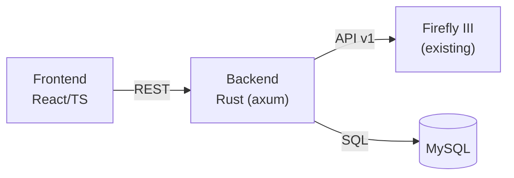
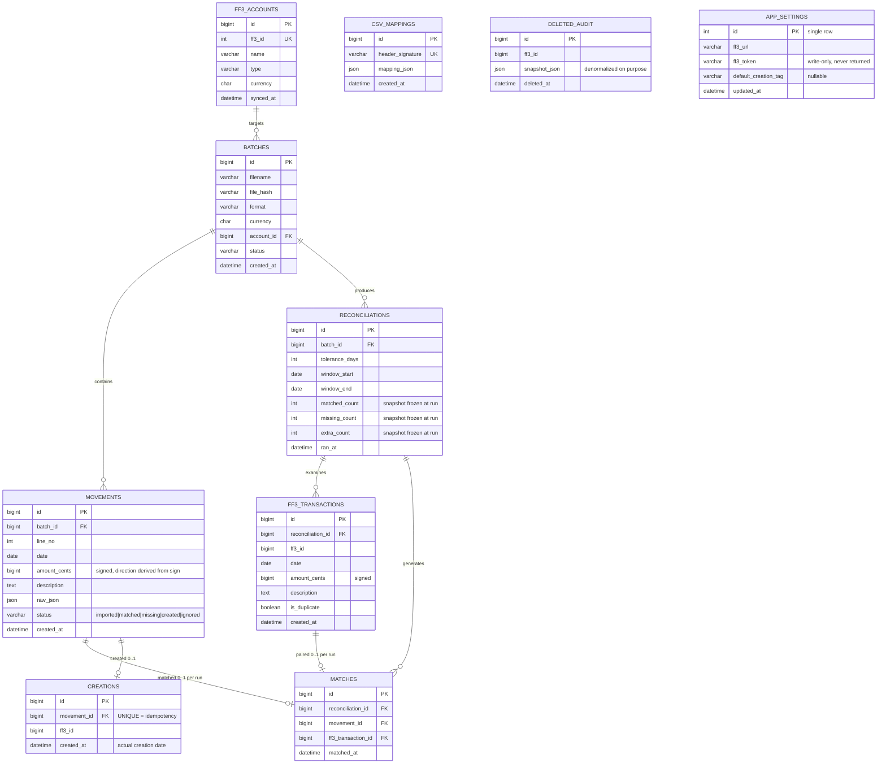

# TRD — Technical Architecture of Bank Reconciliation

| Field | Value |
| --- | --- |
| Project | firefly-manager-movement |
| Version | 0.5 |
| Created | 2026-08-14 |
| Last modified | 2026-09-02 |
| Related PRD | [`2026-08-14-prd-rapprochement-bancaire.md`](./2026-08-14-prd-rapprochement-bancaire.md) |
| Status | Draft in progress |

---

## 1. Overview

Self-hosted web app in 3 services, deployable with Docker Compose next to Firefly III:

| Service | Technology | Role |
| --- | --- | --- |
| Backend | Rust — axum + tokio, reqwest (HTTP client), Diesel (ORM, MySQL) | Internal REST API, CSV parsing, reconciliation engine, Firefly III client |
| Frontend | React + Vite + TypeScript | SPA: upload, mapping, reconciliation table, batch creation |
| Database | MySQL 8 | Persistence of batches, movements, results, CSV mappings |

## 2. Data model

Key constraints:

- `movements`: `UNIQUE(batch_id, line_no)`, `CHECK amount_cents != 0`. No `direction` column: the direction is derived from the sign of `amount_cents` (matching rule "direction" = sign comparison).
- `matches`: `UNIQUE(reconciliation_id, movement_id)` + `UNIQUE(reconciliation_id, ff3_transaction_id)` → 1-to-1 is guaranteed by the schema, not just by convention. Historized per reconciliation run.
- `creations`: `UNIQUE(movement_id)` → creation idempotency (NFR-05). Holds the actual creation date and the provenance ("created by us").
- `ff3_transactions`: `UNIQUE(reconciliation_id, ff3_id)`. Per-run cache: the `extra` group and the `duplicate` flag live there (solves RF-13 re-reconciliation and RF-15 duplicates).
- `ff3_accounts`: `UNIQUE(ff3_id)`. Local cache synced on demand (when launching a reconciliation or via a dedicated endpoint); avoids repeated API calls and provides a displayable name.
- `amount_cents`: signed BIGINT (cents), never floats (NFR-06).
- `raw_json`: raw file line, for audit and re-parsing.
- `app_settings`: single row. `ff3_token` is write-only (never returned to the frontend, NFR-02); `default_creation_tag` is nullable (empty = no default tag, RF-19 v0.7). Replaces environment-variable configuration since v0.6 (RF-19).
- Assumed and justified denormalizations:
  - `reconciliations` counters = snapshot frozen at run time (audit);
  - `movements.status` = current state from the latest run + user actions, indexed for filtering;
  - `deleted_audit.snapshot_json` = point-in-time, intentionally not normalized.
- Semantics of `movements.status`: reflects the latest run (`imported` → `matched`/`missing`); `created` and `ignored` are set by user action. A confirmation re-reconciliation moves `created` → `matched` without losing information (provenance stays in `creations`).
- Batch statuses (`batches.status`): `parsed` → `reconciled` → `applied` (see PRD section 4). A batch in `parsed` status can be deleted with its movements (`DELETE /api/imports/{id}`); `reconciled`/`applied` batches are immutable (RF-09).
- Indexes: `movements(batch_id, status)`, `movements(batch_id, date)`, `ff3_transactions(reconciliation_id, amount_cents)`.

## 3. Backend API

| Method | Route | Role |
| --- | --- | --- |
| POST | `/api/imports` | File upload → batch creation + parse; **409 Conflict if the file name already exists** |
| GET | `/api/imports` / `/api/imports/{id}` | List / batch detail |
| PUT | `/api/imports/{id}/mapping` | Save CSV mapping |
| POST | `/api/imports/{id}/reconcile` | Run the reconciliation |
| GET | `/api/imports/{id}/results` | Results in 3 groups |
| POST | `/api/imports/{id}/apply` | Create the selected missing transactions in Firefly III |
| DELETE | `/api/imports/{id}` | Delete a batch in `parsed` status (+ its movements) — 409 if the batch is not `parsed`; response `200 {id, status: "deleted"}` |
| GET | `/api/firefly/accounts` | Read proxy of asset accounts |
| GET | `/api/firefly/tags`, `/api/firefly/categories`, `/api/firefly/budgets` | Read proxies for the personalization pickers and the default creation tag (RF-08, RF-19) |
| GET / PUT | `/api/settings` | App settings (FF3 URL, token, default creation tag) — token write-only, never returned (RF-19) |
| QUERY | `/api/firefly/accounts/{id}/transactions` | Read proxy of an account's transactions over a period — filters in body: `{start, end}` (RF-14) |
| DELETE | `/api/firefly/transactions/{id}` | Duplicate deletion with audit snapshot (RF-15) |

Notes:

- Batch currency (`POST /api/imports`, `currency` field): since frontend v1.5, it is **derived from the FF3 account selected** in the import wizard and transmitted as-is; the backend keeps its `EUR` default if the field is absent (contract unchanged).
- **Duplicate file names**: `POST /api/imports` refuses a file whose name already exists in an existing batch — `find_by_filename` check before insertion (RF-16, case-insensitive via MySQL collation). The wizard also pre-checks client-side against the batch list and blocks the upload with an inline error.
- **Mapping probe flow**: when no mapping is memorized or auto-detected, the wizard performs a "probe" upload (headers only, 0 movements, batch in `parsed` status). Upon mapping confirmation, the probe is deleted (`DELETE /api/imports/{id}`) and the file is re-uploaded with the confirmed columns — no orphan batches.
- `POST /apply` is idempotent per movement: before each creation, check the existence of a row in `creations` (`UNIQUE(movement_id)`, NFR-05); skip already-created movements.
- `POST /apply` body (v0.7): for each selected movement, the **resolved** customization — counterparty account (required), and optionally description, category, budget, tags, notes, attachment. Bulk-panel merging (fill-only) and default-tag pre-fill are resolved client-side; the tags sent are the user's final selection. The backend **always appends the origin trace tag** (`ffm:<filename>:<batchId>`, RF-11) in addition — it is never part of, nor replaced by, the user's tags.
- Firefly III API errors during a batch `apply`: handled per movement, the batch continues, final report per movement (success/failure/reason).
- **QUERY method (RFC 9295)**: used only for routes with complex filters in body (reads with search criteria). Simple retrievals by ID or full lists stay in GET. The backend translates `QUERY` → `GET` when calling the Firefly III API (which stays GET). Requires registering the method explicitly in axum (`Route::on("QUERY", handler)` or equivalent macro).

## 4. Firefly III integration (API v1)

| Usage | Endpoint |
| --- | --- |
| Auth | `Authorization: Bearer <token>` header (personal access token; OAuth2 also supported) |
| Accounts | `GET /api/v1/accounts?type=asset` |
| Tags / categories / budgets | `GET /api/v1/tags`, `GET /api/v1/categories`, `GET /api/v1/budgets` — feed the pickers and the default creation tag (RF-08, RF-19) |
| Transactions | `GET /api/v1/accounts/{id}/transactions?start=..&end=..` (exhaustive pagination) — called by the backend by translating our internal `QUERY` |
| Creation | `POST /api/v1/transactions` — body is `{ "transactions": [...] }` at top level (FF3 v1 `TransactionStore` schema; unlike other endpoints, the transactions store request does NOT use the JSON-API `data`/`attributes` wrapper) |
| Deletion | `DELETE /api/v1/transactions/{id}` |
| Health | `GET /api/v1/about` |

Backend configuration (environment variables):

| Variable | Description |
| --- | --- |
| `FF3_URL` | Firefly III instance URL |
| `FF3_TOKEN` | API token (never exposed to the frontend, NFR-02) |
| `DATABASE_URL` | MySQL connection string |
| `MATCH_TOLERANCE_DAYS` | Default date tolerance (default 0) |

`FF3_URL` and `FF3_TOKEN` are **superseded by the app settings** (RF-19, v0.6): once a connection is saved, settings take precedence; the variables only serve as deployment-time defaults before any settings exist.

The frontend never talks to Firefly III directly: everything goes through the backend.

## 5. File parsing

- **CSV**: delimiter and encoding detection; if the headers match a memorized mapping (`csv_mappings.header_signature`, hash of normalized headers), automatic application; otherwise manual mapping is required. XLSX files must be converted to CSV by the user before import (native XLSX/OFX support planned for V2).
- **Origin-account column (v0.7)**: the mapping can bind an optional origin-account column (RF-02). The parsed distinct values are exposed with the batch preview to feed the account auto-suggestion (RF-04: match against `ff3_accounts` by IBAN, account number or name). No dedicated schema column — the value stays derivable from `raw_json` + the stored mapping.
- Invalid lines: kept with the error attached, exposed in the preview (RF-03).
- When the CSV requires manual mapping, the preview displays an explanatory message (0 valid rows) and the wizard guides the user to the mapping step (RF-02, v0.5 amendment).

## 6. Reconciliation engine

1. Load the batch movements (`status != ignored`).
2. Fetch the Firefly III transactions of the target account over `[min_date - window, max_date + window]`, exhaustive pagination.
3. Index both sets by `amount_cents` key (the direction is encoded in the sign of each amount).
4. For each key, pair 1-to-1 chronologically within the date tolerance; Firefly III transactions outnumbering a given bank movement are flagged `is_duplicate = true` (RF-15).
5. Produce the 3 groups; persist a `reconciliations` row (snapshot counters) + the examined `ff3_transactions` (with `is_duplicate` flag) + the 1-to-1 `matches`; update the movement statuses (`imported` → `matched`/`missing`).

Target complexity: O(n log n) on the statement; 1,000 movements < 5 s excluding API latency (NFR-04).

## 7. Deployment

Docker Compose: 3 services (`backend`, `frontend`, `mysql`) + shared network with the existing Firefly III instance. Schema migrations managed by Diesel (`diesel migration run`) at backend startup.

ORM note: Diesel is synchronous by default; integration with axum/tokio uses `diesel-async` (async MySQL pool) to avoid blocking the runtime.

## 8. Open decisions

| # | Topic | Options |
| --- | --- | --- |
| D1 | Rust backend framework | axum (recommended) vs actix-web |
| D2 | Amount representation | **Settled**: signed BIGINT (cents), direction derived from the sign — no `direction` column and no DECIMAL. |
| D3 | Re-reconciliation strategy after `apply` | full vs incremental on created movements |
